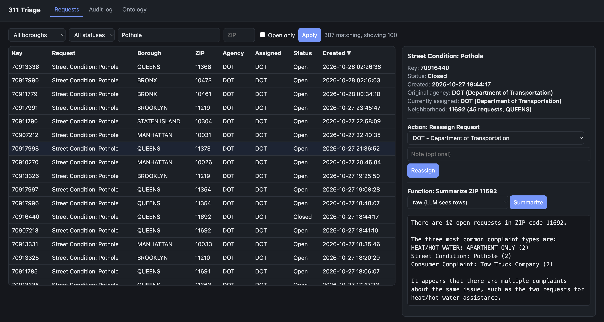
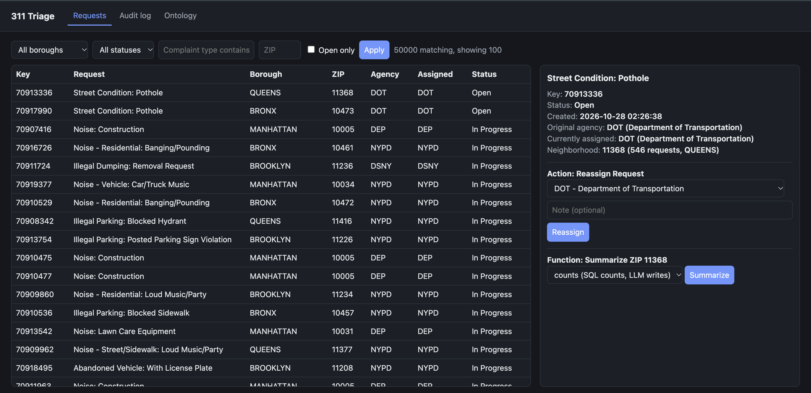
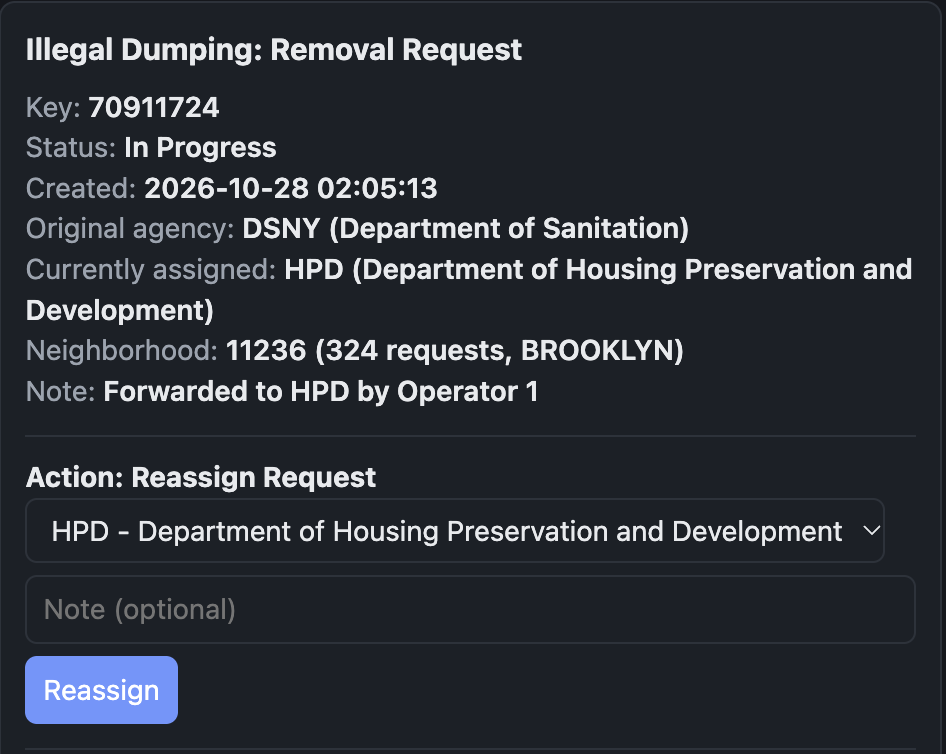
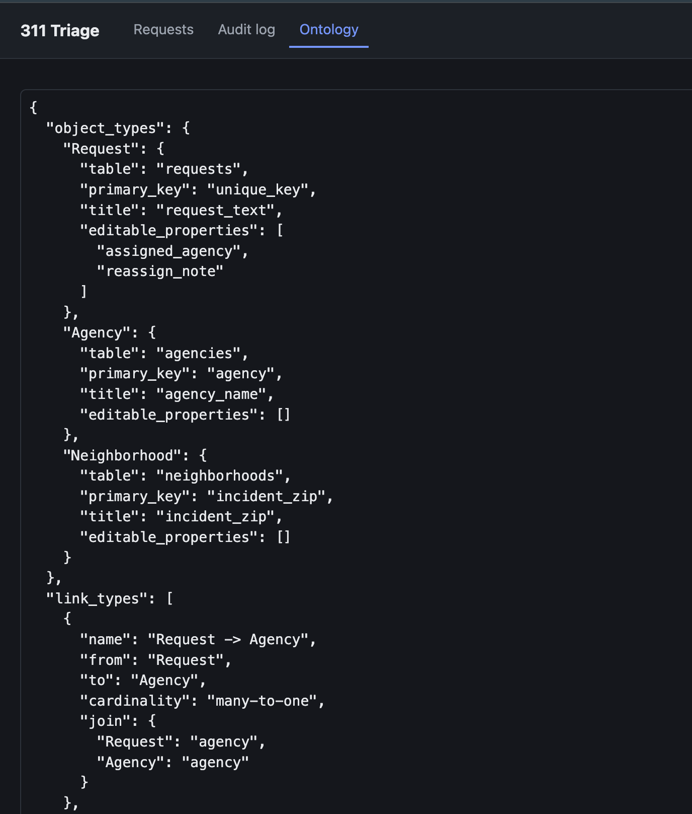
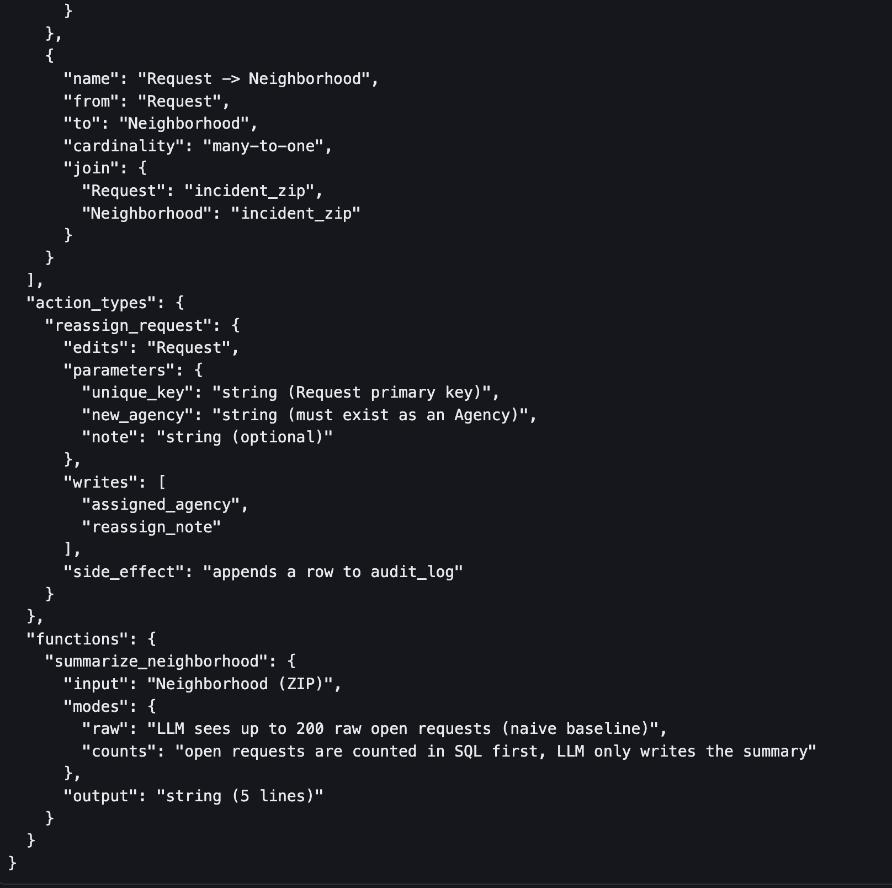
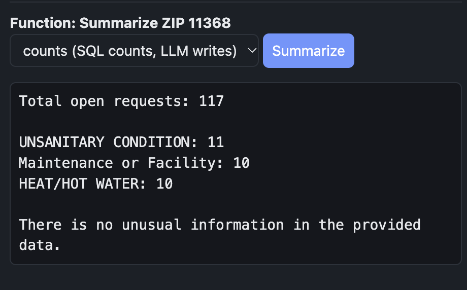
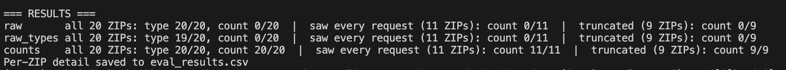

# 311 Triage: an ontology-driven operational app

## Problem statement
Dispatchers at a city operations desk face thousands of open 311 requests. Some sit with the wrong agency, and there is no quick way to see what is happening in one ZIP code. This project builds the smallest useful fix: one triage view with a write-back reassign action and a short, grounded summary per ZIP. Evaluation showed that a local 8B model cannot count requests reliably, so counting moved into SQL and the model only writes.

## What it is
A small operational app organized around an ontology: typed objects, links between them, write-back actions, and an LLM function that works on objects. It runs locally (DuckDB, FastAPI, a local Llama model through Ollama). The table maps each piece to its Palantir Foundry and AIP counterpart.

| This project | Foundry / AIP equivalent |
|---|---|
| `out/*.csv` from NYC Open Data, loaded into DuckDB | Datasets and pipeline |
| `ontology.py`: Request, Agency, Neighborhood | Object types in the Ontology |
| Links Request to Agency, Request to Neighborhood | Link types |
| `POST /api/actions/reassign-request` with validation and an audit log | Action type with write-back |
| `static/index.html`: filter, table, object panel, reassign form | Workshop module |
| `POST /api/functions/summarize-neighborhood` | AIP Logic function |
| `eval.py`: 20 ZIPs scored against ground truth computed from the data | AIP Evals |

Built without Foundry access (Palantir AIP waitlist). The structure is designed to port over.

## Screenshots

**Triage view: search, sort, and filter 50,000 requests**


**Object panel: linked Agency and Neighborhood, plus the Reassign Request action**


**Audit log: every write-back is recorded**


**The ontology: object types, link types, action, and function**



**LLM function: a grounded 5-line summary for one ZIP code**


**Evaluation: three designs on 20 ZIPs**


## Run it
```bash
python -m venv .venv && source .venv/bin/activate
pip install -r requirements.txt
python prep_311.py                  # pulls ~30 days of NYC 311 data into out/
# Install Ollama from ollama.com, then:
ollama pull llama3.1:8b
uvicorn app:app --port 8000         # open http://localhost:8000
python eval.py                      # in a second terminal, with the server running
```
To run the UI without a model, use `LLM_BACKEND=stub uvicorn app:app`. Never report eval numbers from the stub. To reset all edits, delete `data.duckdb`.

## Measured results
20 ZIP codes, ground truth computed from the data. Model: Llama 3.1 8B via Ollama, temperature 0. Produced by `python eval.py`; per-ZIP detail, including every summary, is in `eval_results.csv`.

| Design | True top type mentioned (anywhere) | Top count correct (all 20) | Count correct, model saw every request (11 ZIPs) | Count correct, input truncated (9 ZIPs) |
|---|---|---|---|---|
| raw: rows shown as "type: descriptor" | 20/20 | 0/20 | 0/11 | 0/9 |
| raw_types: rows shown as "type" only (fairer baseline) | 19/20 | 0/20 | 0/11 | 0/9 |
| counts: SQL counts first, LLM writes the summary | 20/20 | 20/20 | 11/11 | 9/9 |

**Finding 1 (a flaw in the first baseline).** The raw design scored 0/20 on counts, but part of that came from the prompt format: rows were shown as "type: descriptor," so the model counted at sub-type level. In ZIP 11368 it reported "HEAT/HOT WATER: ENTIRE BUILDING (7)," which is exact for that sub-type, while the ground truth counts whole complaint types (top: UNSANITARY CONDITION, 11). It also miscounted "UNSANITARY CONDITION: PESTS" as 7 when the true number is 6. That flaw led to a fairer baseline, raw_types.

**Finding 2 (what the fairer baseline shows).** With one complaint type per line and every request in view (11 ZIPs with 91 to 192 open requests), Llama 3.1 8B still got the top count wrong in all 11. The errors were confident specific numbers, not hedges: in ZIP 11368 it reported HEAT/HOT WATER 14 and UNSANITARY CONDITION 13, while the truth is UNSANITARY CONDITION 11 and HEAT/HOT WATER 10, so both the counts and the ranking were wrong. The failure is the model's counting, not truncation or prompt format, which is why the final design never asks the model to count.

**What changed:** the model no longer counts. Counting moved into SQL and the model only writes the summary.

## Limitations
- Public data, no real dispatchers: the evaluation measures summary correctness, not usage.
- The raw design only sees the 200 most recent open requests for a ZIP, so it is a deliberately naive baseline.
- Ground truth is computed from the same data, so this checks faithfulness to the data, not usefulness to a dispatcher.
- The counts design
